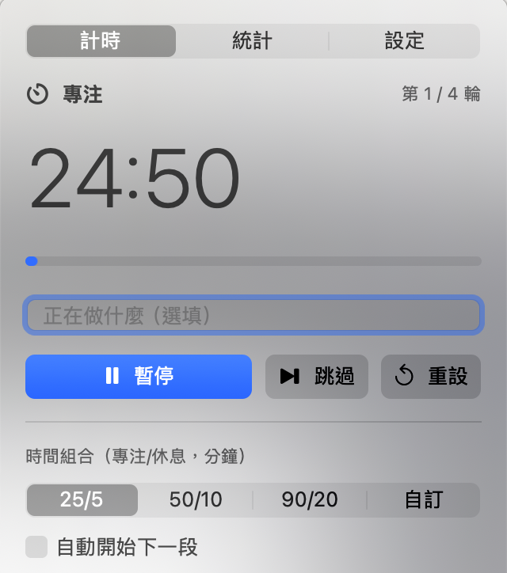

# FocusBar
A pomodoro focus timer that lives in the macOS menu bar.

FocusBar 是一個住在 Mac 選單列的專注計時器（番茄鐘）。選單列上直接顯示剩餘時間，點開就能開始、暫停、看今天做了多少。沒有帳號、不連網、資料只存在你的電腦。



## 功能

- 選單列顯示圖示與剩餘時間（例如 `24:13`），數字等寬，不會左右跳動；可在設定改成只顯示圖示
- 開始、暫停、繼續、跳過、重設；顯示目前階段（專注、短休息、長休息）與第幾輪
- 預設組合 25/5、50/10、90/20，或自訂專注、短休、長休分鐘數、幾輪後長休息、是否自動開始下一段
- 階段結束時發送系統通知，可選提示音（系統內建音效）
- 統計：今日專注分鐘數、完成輪數、最近 7 天長條圖（Swift Charts）
- 每段專注可加「正在做什麼」標籤，統計會依標籤分類
- 開機自動啟動、全域快捷鍵 `⌃⌥⌘F`（開始／暫停）、不顯示在 Dock
- 睡眠與喚醒：以「結束時間點」計算剩餘時間，電腦睡著再醒來，時間仍然正確；手動改系統時間也不影響倒數
- 紀錄檔以原子方式寫入；檔案損毀時會先備份再復原

## 系統需求

macOS 14 (Sonoma) 或更新版本。

## 安裝（下載現成的 App）

1. 到本專案 GitHub 頁面右側的 **Releases**，下載 `FocusBar-0.1.0.zip`。
2. 雙擊 zip 解壓縮，會得到 `FocusBar.app`。
3. 把 `FocusBar.app` 拖進「應用程式」資料夾。
4. 雙擊打開。因為這個 App 沒有付費的 Apple 開發者簽章，第一次會被 macOS 擋下，出現「無法打開」的訊息。請這樣做：
   1. 先按訊息視窗的「完成」（或「好」）關掉它。
   2. 打開「系統設定」>「隱私權與安全性」。
   3. 往下捲到「安全性」區塊，會看到「已阻擋 FocusBar 以保護你的 Mac」，按旁邊的「仍要打開」。
   4. 輸入密碼或用 Touch ID 確認，再按「打開」。
5. 之後選單列右側會出現一個碼錶圖示與時間，點它就能開啟面板。第一次按「開始」時，macOS 會問是否允許通知，請按「允許」。

如果選單列圖示看不到，可能是選單列空間不夠或被選單列整理工具收起來了，先把其他圖示關掉幾個試試。

## 從原始碼建置

需要 Xcode 15 以上（或安裝了 Swift 5.9 以上的 Command Line Tools）。

```bash
git clone <本專案的網址>
cd FocusBar
scripts/build-app.sh
open dist/FocusBar.app
```

`scripts/build-app.sh` 會做這些事：用 release 模式編譯、用程式畫出 App 圖示並轉成 `.icns`、組成 `FocusBar.app`（含 `Info.plist`）、ad-hoc 簽章，最後壓縮成 `dist/FocusBar-0.1.0.zip`。`dist/` 不會進 git。

只想快速試跑（沒有 bundle，所以不會有系統通知）：

```bash
swift run FocusBar
```

## 使用說明

- 點選單列的計時器打開面板，最上方可切換「計時／統計／設定」。
- 「計時」：按「開始」倒數。專注時可在輸入框寫下正在做什麼（例如「英文」），右邊的按鈕可選最近用過的標籤。「跳過」會直接進入下一段，被跳過的專注不會計入統計；「重設」讓這一段回到尚未開始。
- 面板下方選預設組合；選「自訂」會出現分鐘數與輪數的調整鈕。
- 「統計」：今日專注、完成輪數、最近 7 天長條圖，以及各標籤的分鐘數。
- 「設定」：選單列是否顯示時間、通知、提示音、開機啟動、全域快捷鍵，以及在 Finder 顯示紀錄檔。
- 專注紀錄存在 `~/Library/Application Support/FocusBar/sessions.json`。想清除紀錄，結束 App 後刪掉這個檔案即可。

## 專案結構

```
Package.swift
Sources/
  FocusCore/          純邏輯，不依賴 UI
    TimeSource.swift      單調時鐘協定與 mm:ss 格式化
    TimerConfig.swift     階段、設定、預設組合
    TimerEngine.swift     計時狀態機
    FocusSession.swift    一筆專注紀錄
    StatsCalculator.swift 統計彙總（跨午夜、依標籤）
    SessionStore.swift    JSON 存取、原子寫入、壞檔復原、舊格式遷移
  FocusBar/           選單列 App（SwiftUI + 少量 AppKit / Carbon）
    FocusBarApp.swift, AppModel.swift, PanelView.swift,
    TimerTab.swift, StatsTab.swift, SettingsTab.swift,
    NotificationManager.swift, GlobalHotKey.swift, Preferences.swift
Tests/FocusCoreTests/ 單元測試
Resources/            Info.plist、App 圖示
scripts/              build-app.sh、make-icon.swift
```

## 跑測試

```bash
swift test
```

測試涵蓋狀態機的所有轉移（開始、暫停、繼續、跳過、完成、長休息判斷、自動開始）、睡眠與系統時間被改的情境（用假時鐘快轉）、統計彙總（跨午夜、跨天、依標籤、時區），以及持久化（原子寫入、壞檔復原、舊版格式遷移）。

## 原理簡介

- **不靠 tick 累加**：開始計時時記下「結束時間點」，剩餘時間永遠是 `結束時間點 - 現在`。畫面每 0.25 秒重新計算一次，但那只是重繪，不影響準確度。
- **單調時鐘**：時間來源是 `ContinuousClock`，它在系統睡眠時仍繼續走，也不受使用者改系統時間影響。睡醒後若已超過結束時間，會且只會結束一次；若開了自動開始，下一段從醒來的那一刻起算，不會連續跳好幾段。
- **可測試**：`TimerEngine` 是純值型別，時鐘由外部注入，測試時直接快轉。
- **紀錄檔**：只存「結束時間 + 長度 + 標籤」。橫跨午夜的專注會依實際重疊時間分到兩天，輪數算在結束的那一天。寫入用暫存檔加 rename，覆寫前保留上一份好檔；讀到壞檔時，先改名備份（`sessions.corrupt-時間.json`），再用上一份好檔還原，沒有才重建空檔。
- **全域快捷鍵**：Carbon 的 `RegisterEventHotKey`，不需要「輔助使用」權限。
- **開機啟動**：`SMAppService.mainApp`，可在「系統設定 > 一般 > 登入項目」看到並管理。

## 授權

MIT License，詳見 [LICENSE](LICENSE)。
